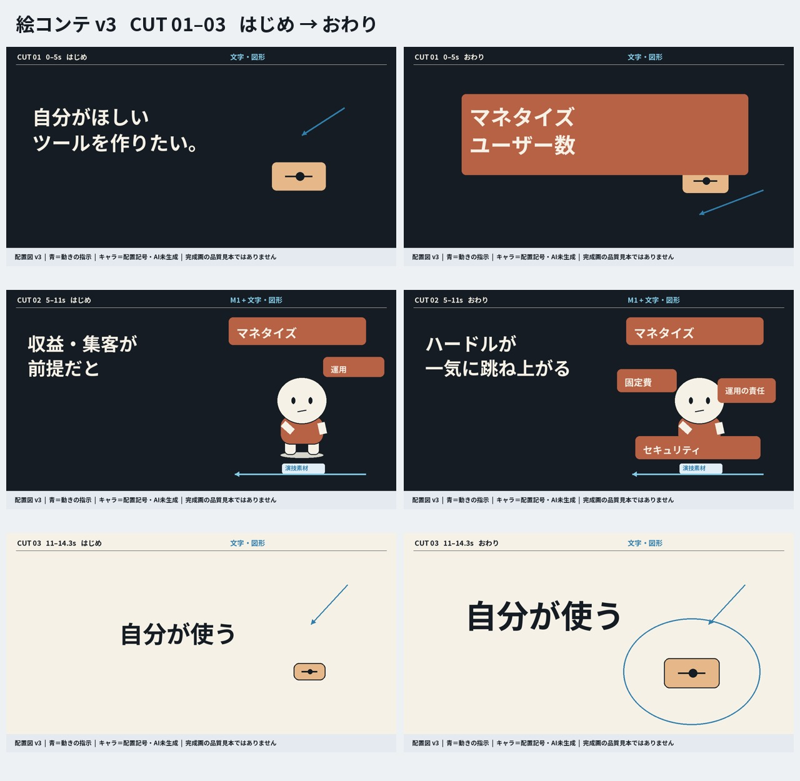
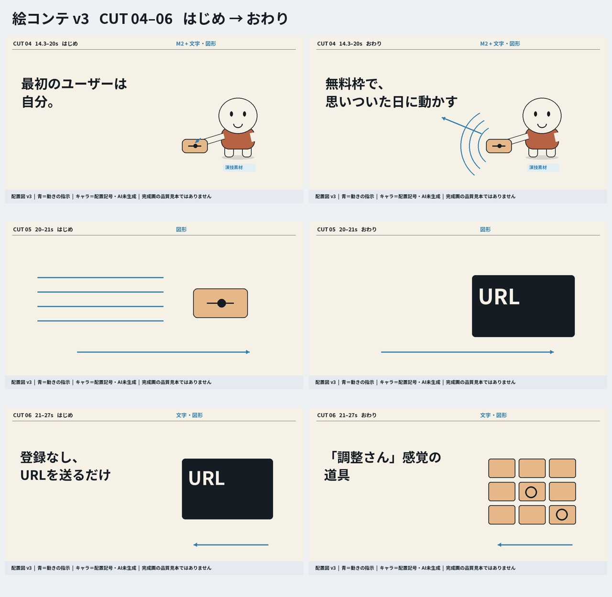
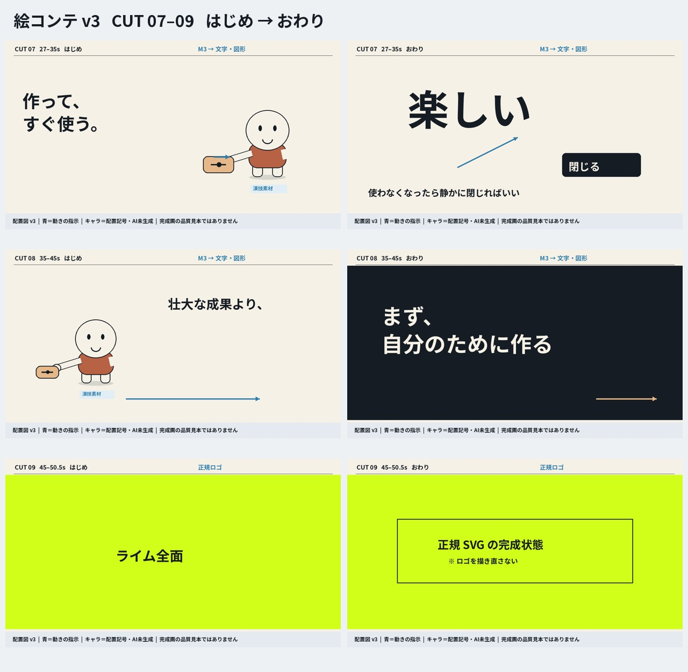

# 配置用絵コンテ v3

2026-10-13。各コマ1280×720。キャラクターは配置記号で、生成済み素材でも最終デザインでもありません。青矢印は移動の指示。文字の順次差替え、途中の演技・接触・構図の動きは [企画書](../../plan.md) を併読してください。ロゴは配置枠だけを示し、完成時は正規SVGを使います。

配置用の図解です。実際のM2の手の方向・M3の両手の動きは制作指示書に従い、道具を実素材へ合わせて配置します。静止画だけで動きや合成品質の合格を判断しないでください。

## CUT 01–03

## CUT 04–06

## CUT 07–09

## 個別コマ

| カット | はじめ | おわり |
|---|---|---|
| 01 | [開始](cut-01-start.png) | [終了](cut-01-end.png) |
| 02 | [開始](cut-02-start.png) | [終了](cut-02-end.png) |
| 03 | [開始](cut-03-start.png) | [終了](cut-03-end.png) |
| 04 | [開始](cut-04-start.png) | [終了](cut-04-end.png) |
| 05 | [開始](cut-05-start.png) | [終了](cut-05-end.png) |
| 06 | [開始](cut-06-start.png) | [終了](cut-06-end.png) |
| 07 | [開始](cut-07-start.png) | [終了](cut-07-end.png) |
| 08 | [開始](cut-08-start.png) | [終了](cut-08-end.png) |
| 09 | [開始](cut-09-start.png) | [終了](cut-09-end.png) |
