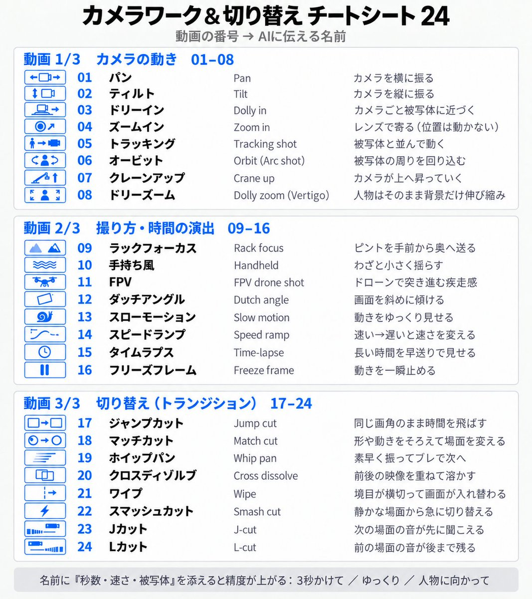

# カメラワーク＆切り替え チートシート 24

企画側が、動画生成の指示や絵コンテの動きを書くときに使う名前。制作側がこの表を根拠に動画AIで素材を作る手順ではない。クレジットを使う生成は、リポジトリ直下の `AGENTS.md`「外部サービスによる動画生成」の事前承認に従う。名前に「秒数・速さ・被写体」を添えると精度が上がる（例: 3秒かけて／ゆっくり／人物に向かって）。

## カメラの動き 01–08
| No | 名前 | AIに伝える名前 | 意味 |
|---|---|---|---|
| 01 | パン | Pan | カメラを横に振る |
| 02 | ティルト | Tilt | カメラを縦に振る |
| 03 | ドリーイン | Dolly in | カメラごと被写体に近づく |
| 04 | ズームイン | Zoom in | レンズで寄る（位置は動かない） |
| 05 | トラッキング | Tracking shot | 被写体と並んで動く |
| 06 | オービット | Orbit (Arc shot) | 被写体の周りを回り込む |
| 07 | クレーンアップ | Crane up | カメラが上へ昇っていく |
| 08 | ドリーズーム | Dolly zoom (Vertigo) | 人物はそのまま背景だけ伸び縮み |

## 撮り方・時間の演出 09–16
| No | 名前 | AIに伝える名前 | 意味 |
|---|---|---|---|
| 09 | ラックフォーカス | Rack focus | ピントを手前から奥へ送る |
| 10 | 手持ち風 | Handheld | わざと小さく揺らす |
| 11 | FPV | FPV drone shot | ドローンで突き進む疾走感 |
| 12 | ダッチアングル | Dutch angle | 画面を斜めに傾ける |
| 13 | スローモーション | Slow motion | 動きをゆっくり見せる |
| 14 | スピードランプ | Speed ramp | 速い→遅いと速さを変える |
| 15 | タイムラプス | Time-lapse | 長い時間を早送りで見せる |
| 16 | フリーズフレーム | Freeze frame | 動きを一瞬止める |

## 切り替え（トランジション） 17–24
| No | 名前 | AIに伝える名前 | 意味 |
|---|---|---|---|
| 17 | ジャンプカット | Jump cut | 同じ画角のまま時間を飛ばす |
| 18 | マッチカット | Match cut | 形や動きをそろえて場面を変える |
| 19 | ホイップパン | Whip pan | 素早く振ってブレで次へ |
| 20 | クロスディゾルブ | Cross dissolve | 前後の映像を重ねて溶かす |
| 21 | ワイプ | Wipe | 境目が横切って画面が入れ替わる |
| 22 | スマッシュカット | Smash cut | 静かな場面から急に切り替える |
| 23 | Jカット | J-cut | 次の場面の音が先に聞こえる |
| 24 | Lカット | L-cut | 前の場面の音が後まで残る |

